# go-sudoku-solver

<!-- coverage:START -->
coverage: 95.9% of statements
<!-- coverage:END -->

## Table of contents

1. [Pictures](#pictures)
2. [Data and formats](#data-and-formats)
3. [Architecture and flows](#architecture-and-flows)
4. [Local development](#local-development)
5. [Production environment setup](#production-environment-setup)
6. [Surfaces](#surfaces)
7. [QA harness](#qa-harness)
8. [Build logs](#build-logs)

## Pictures

1. 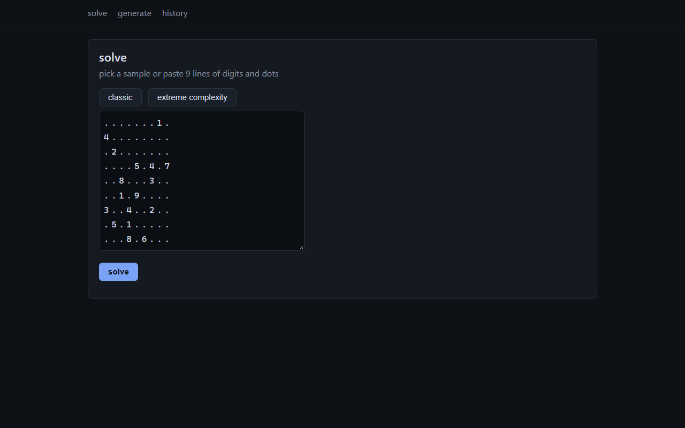

   the solve home at `/`, textarea for the 9-line grid, results swapped in by htmx

2. 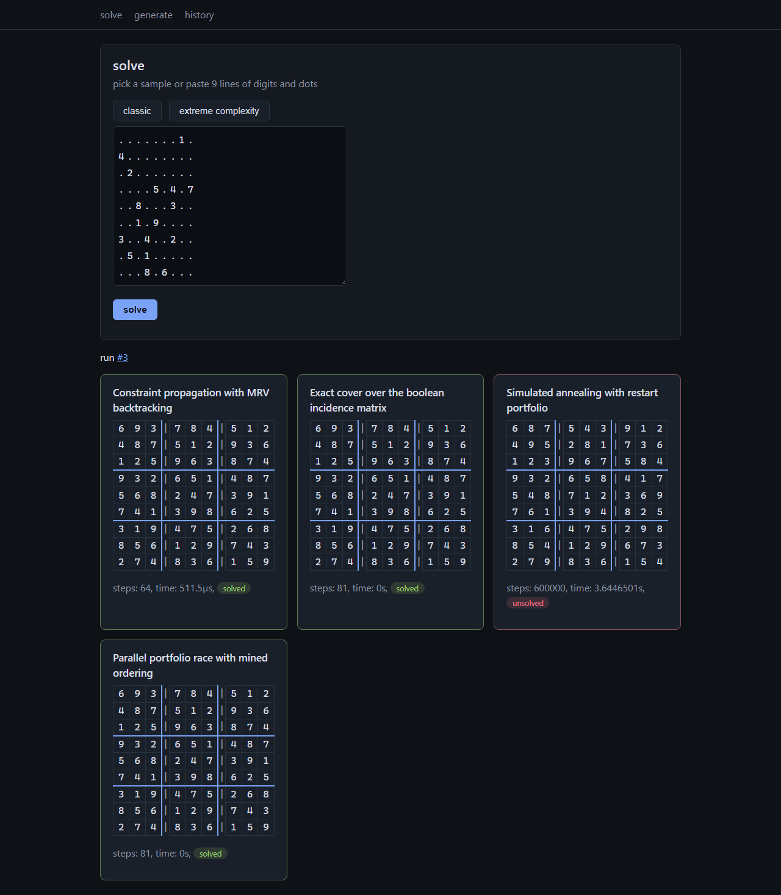

   all four method cards after a solve, grids, step counts, times

3. 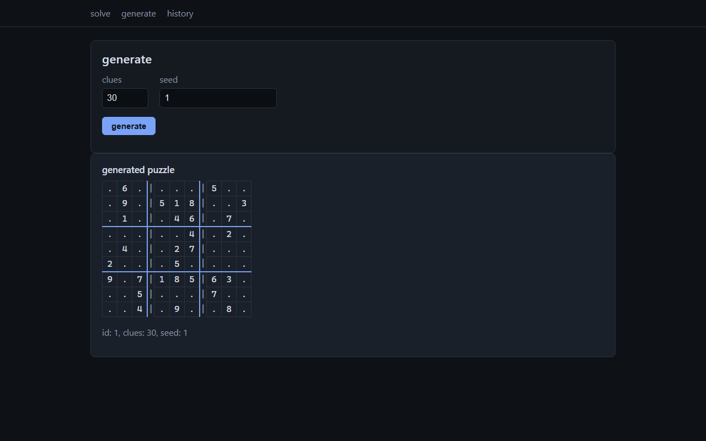

   the generator at `/generate`, clue target and seed inputs, the emitted grid

4. 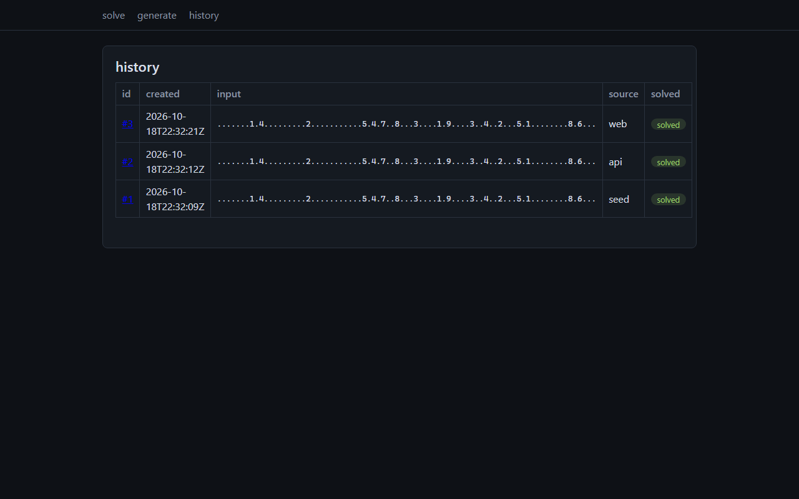

   the history list at `/history`, one row per persisted run with paging

5. 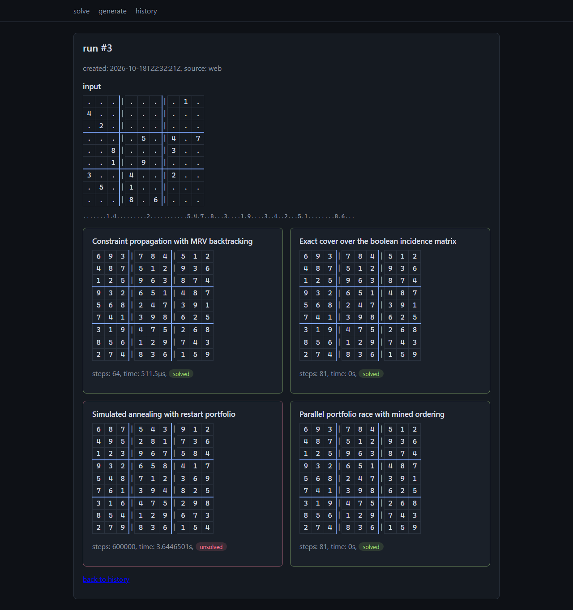

   one run at `/runs/{id}`, input grid and every method result

6. 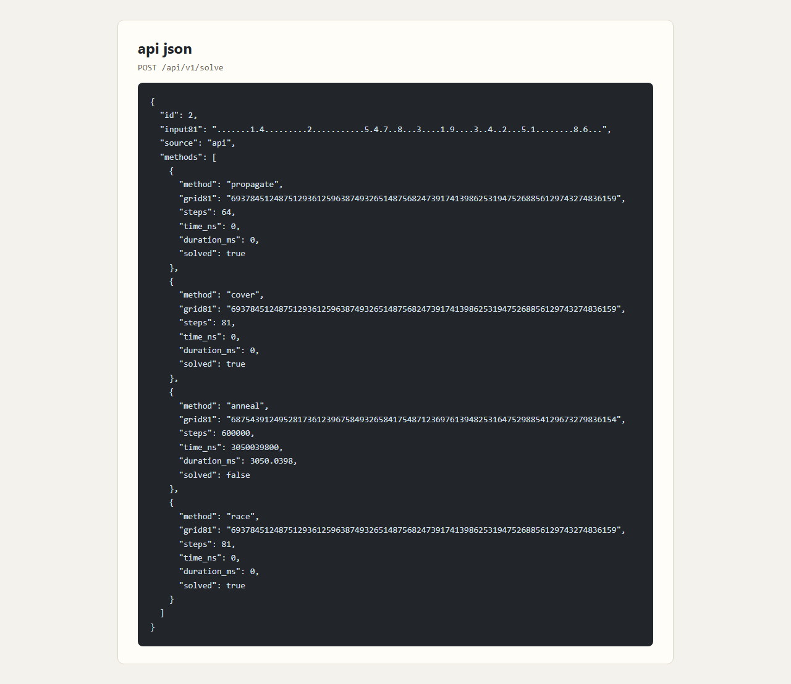

   a `GET /api/v1/runs` response rendered in the browser

7. 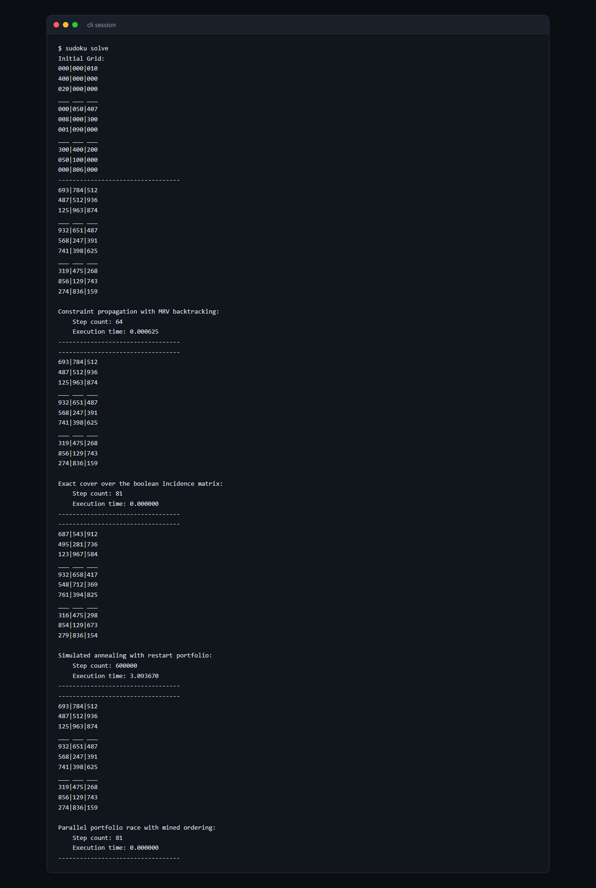

   a terminal session, the classic sample piped through `dist/sudoku`

8. 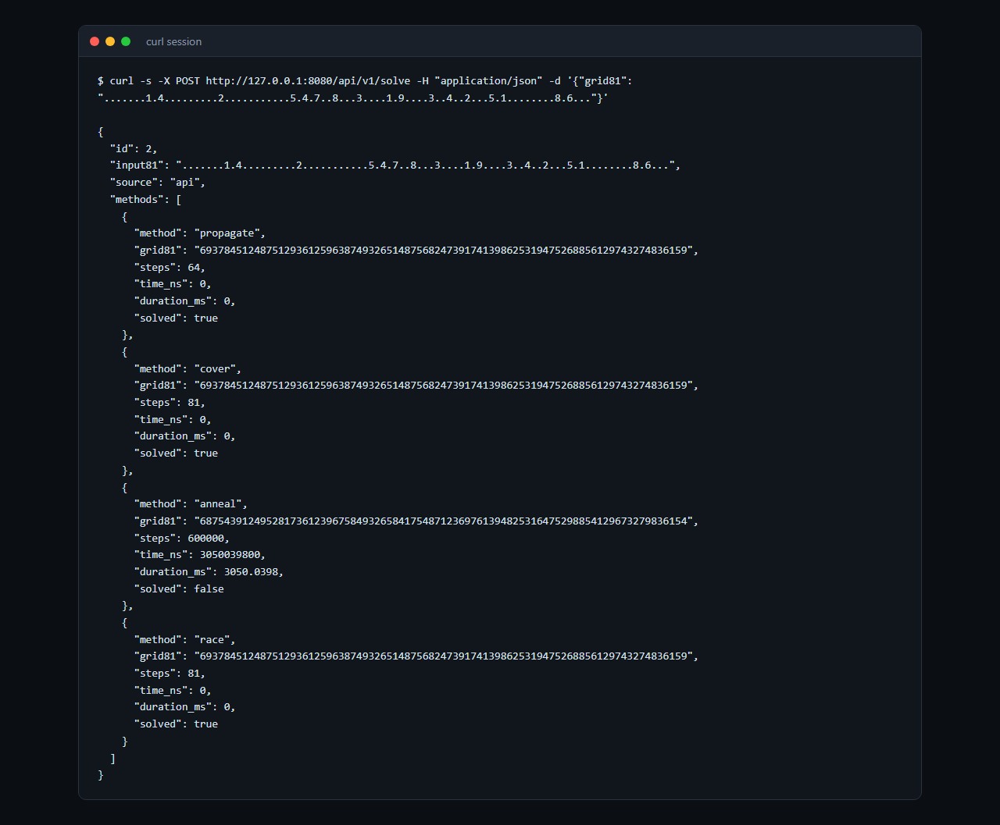

   a curl session against the api, solve then runs

## Data and formats

Input grammar. Exactly 9 lines, exactly 9 characters each, `.` or a digit 1 to 9 per cell. Anything else is a parse error: the message goes to stderr prefixed `Error reading input:` and the process exits 1. Trailing lines after 9 valid ones are ignored, a tolerance inherited from the legacy parser. The canonical example, the classic 17-clue sample:

```text
.......1.
4........
.2.......
....5.4.7
..8...3..
..1.9....
3..4..2..
.5.1.....
...8.6...
```

The extreme complexity sample, 21 clues evolved by `tools/evolve` to force 4646 propagate steps, 72.6 times the classic sample's 64:

```text
..4...8..
32...9.1.
.....13..
...1...5.
......4.8
.6...2...
..8.9.5..
...2.....
..6.3..9.
```

The report format. `sudoku` with no command, or `sudoku solve`, reads the grid from stdin and prints one report. An `Initial Grid:` block, then for each of the four methods in registry order a separator, the method's rendered grid, its label, step count, and execution time. Real output for the sample through the first method's step count, the execution time line varies by machine:

```text
Initial Grid:
000|000|010
400|000|000
020|000|000
___ ___ ___
000|050|407
008|000|300
001|090|000
___ ___ ___
300|400|200
050|100|000
000|806|000
----------------------------------
693|784|512
487|512|936
125|963|874
___ ___ ___
932|651|487
568|247|391
741|398|625
___ ___ ___
319|475|268
856|129|743
274|836|159

Constraint propagation with MRV backtracking:
    Step count: 64
    Execution time: 0.000524
```

Step counts mean different work per method: propagate counts digit placements, cover counts rows selected from the matrix, anneal counts proposals evaluated, race sums every racer including unwound stragglers. The exact contract is pinned in [docs/qa/baselines.md](docs/qa/baselines.md).

Solver times from one `make bench` run on the development machine, the values vary by machine:

| method | sample | time per op |
|---|---|---|
| propagate | classic | 308 us |
| propagate | extreme complexity | 59.8 ms |
| cover | extreme complexity | 4.3 ms |
| anneal | extreme complexity | 1.08 s |
| race | extreme complexity | 11.0 ms |

The exact cover matrix. The cover solver works over a 729 by 324 boolean incidence matrix: one row per (cell, digit) pair, 81 cells times 9 digits, and four column families of 81 each, cell filled, row-unit digit, column-unit digit, box-unit digit. A row satisfies exactly 4 columns, a solution is a subset of 81 rows covering all 324 exactly once, and each selected row counts as one step. Node visits cap at `SUDOKU_COVER_NODE_CAP`, default 1048576, an unsolved report at the cap instead of an unbounded search.

The omega paragraph, existence bound versus runnable. The claim omega <= 9/4 for matrix multiplication rests on a family of bilinear algorithms whose existence is formalized over the complex numbers: no implementation of that family ships here. What is runnable is the certificate machinery in `internal/matmul`: a profile checker enforcing the 4 laws, symmetry, unit row, discrete concavity, and shifted tripling `P(a, 3h+a-1) >= 3P(a, h)`. The rank profile `a+b-1` passes three laws and fails exactly tripling at `a = 2`, `h = 1`, where `P(2, 4) = 5 < 3 P(2, 1) = 6`, the geometry profile `sqrt(ab(a+b-1))` passes all four, and the cap ladder `CapT(a) = 3ln(2a-1) / (4ln a)` descends from 1.188721876 at `a = 2` to 0.787499974 at `a = 1048576` and never reaches 3/4. Tests in the package pin every one of these values. The same package supplies the boolean multiplication that precomputes the cover solver's conflict matrix once per process, and its dense Strassen lane drives the trainer's normal-equation multiply, switching at `SUDOKU_MATMUL_CUTOFF`, default 64.

The database. `database/sudoku.db` is sqlite in WAL mode with a 5s busy timeout, created on first serve. Three tables: `runs(id, created_at, input81, source)` with source one of seed, web, api, `run_methods(run_id, method, grid81, steps, time_ns, solved)`, and `puzzles(id, grid81, clues, seed, created_at)`. An empty database is seeded with the classic sample as source seed, exactly once. The database directory is gitignored, delete the file to reseed.

## Architecture and flows

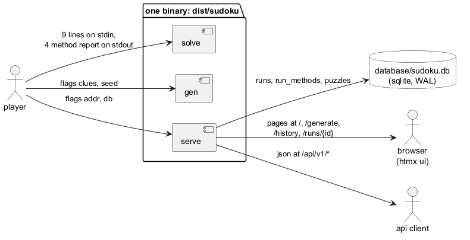

the system overview, one binary, three entry points, browser and api client over one server, sqlite behind

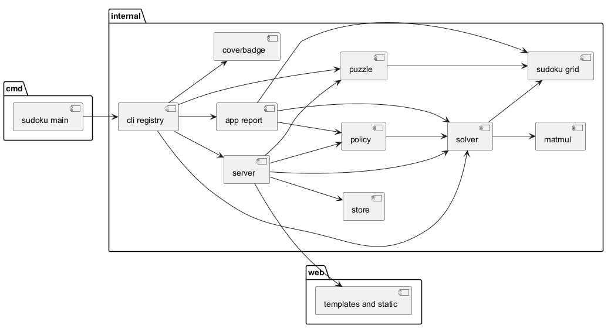

the internal package dependency graph

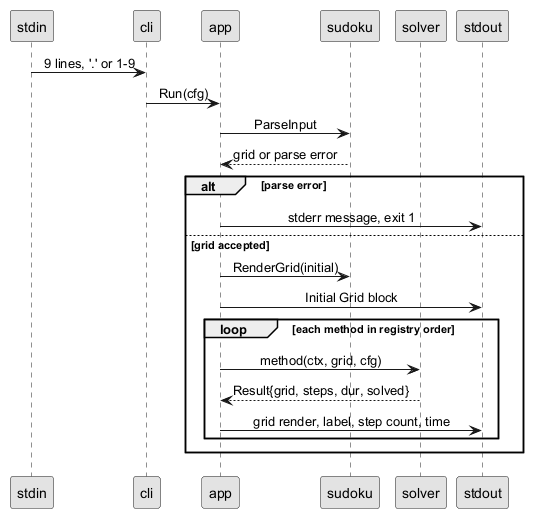

the solve pipeline from stdin through parsing to the four-method report

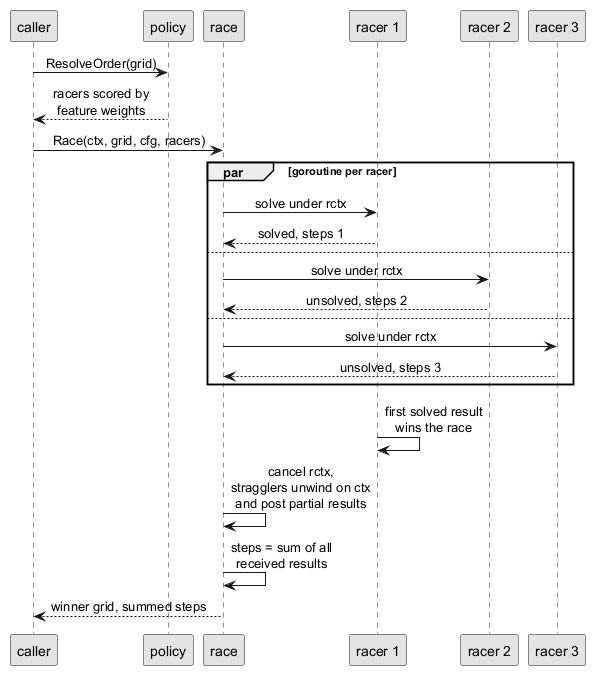

the portfolio race, first solved cancels the field, stragglers unwind, steps sum

## Local development

Prerequisites: Go (the toolchain pin lives in `go.mod`), a C toolchain for CGO (on Windows the Makefile pins the scoop mingw-winlibs UCRT gcc and exports `CC`/`CXX`), Chrome or Edge for screenshots, and Java or Docker for the plantuml diagrams.

1. Clone and build:

```sh
git clone https://github.com/lavantien/go-sudoku-solver
cd go-sudoku-solver
make build
```

`make build` emits `dist/sudoku`, named `dist/sudoku.exe` on Windows, with `CGO_ENABLED=1`. Any manual `go` command needs the same treatment: `CGO_ENABLED=1 go build ./cmd/sudoku`.

2. Run the server:

```sh
make run
```

That is `go run ./cmd/sudoku serve --addr 127.0.0.1:8080 --db database/sudoku.db`. The first run creates and seeds `database/sudoku.db` with the classic sample, the seed is never reapplied, solves persist. The web ui is at http://127.0.0.1:8080/.

3. Exercise the cli:

```sh
dist/sudoku version
dist/sudoku gen --clues 30 --seed 1
dist/sudoku gen --clues 30 --seed 1 | dist/sudoku
```

Bare `sudoku` and `sudoku solve` are the same command, both read the 9-line grid from stdin and print the report, so the third line pipes a generated puzzle straight back into the solver.

4. Regenerate artifacts:

```sh
make diagrams
make screenshots
make coverage
```

`make diagrams` renders every `docs/diagrams/*.puml` to a committed PNG beside it. `make screenshots` captures the ui and terminal journeys into `project-pictures/`. `make coverage` recomputes coverage and refreshes the badge at the top of this readme.

## Production environment setup

1. Config layering. Built-in defaults, then environment variables. Values that fail to parse fall back to the default silently, the shapes below are the accepted ones. The loader lives in `internal/config`.

2. Environment overrides, the complete set the loader honors:

| variable | shape | overrides |
|---|---|---|
| SUDOKU_WORKERS | int | workers |
| SUDOKU_ANNEAL_RESTARTS | int | anneal.restarts |
| SUDOKU_ANNEAL_ITERATIONS | int | anneal.iterations |
| SUDOKU_ANNEAL_TEMP_START | int | anneal.temp_start |
| SUDOKU_ANNEAL_TEMP_END | int | anneal.temp_end |
| SUDOKU_ANNEAL_SEED | uint | anneal.seed |
| SUDOKU_COVER_NODE_CAP | int | cover node cap |
| SUDOKU_MATMUL_CUTOFF | int | matmul cutoff |
| SUDOKU_GEN_CLUES | int | gen.clues |
| SUDOKU_GEN_SEED | uint | gen.seed |
| SUDOKU_EVOLVE_SEED | uint | evolve.seed |
| SUDOKU_EVOLVE_POPULATION | int | evolve.population |
| SUDOKU_EVOLVE_GENERATIONS | int | evolve.generations |
| SUDOKU_TRAIN_SEEDS | int | train.seeds |
| SUDOKU_TRAIN_TABLE | path | train.table_path |
| SUDOKU_SERVER_ADDR | host:port | server.addr |
| SUDOKU_SERVER_READ_TIMEOUT | duration | server.read_timeout |
| SUDOKU_SERVER_WRITE_TIMEOUT | duration | server.write_timeout |
| SUDOKU_SERVER_IDLE_TIMEOUT | duration | server.idle_timeout |
| SUDOKU_SERVER_SHUTDOWN_TIMEOUT | duration | server.shutdown_timeout |
| SUDOKU_DB_PATH | path | db_path |
| SUDOKU_LOG_LEVEL | discard, debug, info, warn, error | log_level |

`SUDOKU_WORKERS = 1` forces the race to run its racers sequentially. Anneal temperatures are milli-units, the defaults 4000 and 100 mean 4.0 down to 0.1. `SUDOKU_GEN_CLUES` accepts 17 to 81, default 30, and the other defaults are the ones quoted in `internal/config.Defaults`: node cap 1048576, matmul cutoff 64, timeouts 5s, 10s, 60s, 5s, database `database/sudoku.db`.

3. Loopback default. `server.addr` defaults to `127.0.0.1:8080`, the loopback only. Override with `--addr`, `SUDOKU_SERVER_ADDR`, or the `ADDR` make variable.

4. Release binaries. `make release` cross-compiles stripped binaries with zig cc into `dist/release`, `make topics` sets the GitHub topic list, and `make release-upload` publishes the v1.0 GitHub release with those binaries.

## Surfaces

### the sudoku cli

`sudoku` with no command runs solve. An unknown command prints the registry to stderr and exits 2.

| command | flags | purpose |
|---|---|---|
| sudoku solve | none | read the 9-line grid from stdin, print the report |
| sudoku gen | --clues --seed | print one generated puzzle in the 9-line format |
| sudoku serve | --addr --db | serve the htmx ui and the json api |
| sudoku version | none | print `sudoku v1.0` |
| sudoku coverage | --profile --readme | recompute coverage and refresh the readme badge |
| sudoku screenshot | --out dir | capture the ui and terminal journeys, `SUDOKU_BROWSER` picks the browser |

### http routes

One mux serves everything.

Pages and fragments:

| method | path | purpose |
|---|---|---|
| GET | / | solve home, textarea in, htmx results |
| GET | /generate | generator page |
| GET | /history | run history, paged |
| GET | /runs/{id} | one run and its method results |
| POST | /fragment/solve | solve result fragment for htmx swap |
| POST | /fragment/generate | generator output fragment |
| GET | /static/ | embedded assets |

The `/api/v1` JSON surface:

| method | path | purpose |
|---|---|---|
| POST | /api/v1/solve | solve a grid, persist the run |
| GET | /api/v1/runs | run list, limit default 20 max 100, offset |
| GET | /api/v1/runs/{id} | one run as JSON, 404 envelope on a miss |
| POST | /api/v1/generate | generate and persist a puzzle |
| GET | /api/v1/puzzles | generated puzzle list, same paging |
| GET | /api/v1/health | liveness |
| GET | /api/v1/version | build version |
| GET POST | /api/ | JSON 404 catch-all for unknown api paths |

### make targets

`make help` prints this table from the Makefile comments:

```text
help             show this help
all              run the full test suite (default)
build            build the sudoku binary into dist/
test             run the full test suite
test-pkg         run one package's tests: make test-pkg PKG=./internal/config
test-one         run one named test: make test-one PKG=./internal/cli TEST=TestMainBare
race             go test -race over the concurrent core (RACE_PKGS)
vet              go vet
fmt              gofumpt all Go files
fmt-check        gofumpt check mode, fail on drift without editing
lint             golangci-lint run
lint-pkg         lint one package: make lint-pkg PKG=./internal/config
typecheck        compile every package, then go vet
sloc             enforce the 1000-line ceiling on every Go file
fuzz             fuzz every target in the repo for FUZZ_TIME each
fuzz-one         fuzz one target: make fuzz-one PKG=./internal/sudoku FUZZ_TARGET=FuzzParseInput
mutate           mutation-test MUTATE_PKGS, every surviving mutant fails the build
memtest          solver and e2e suites under a hard GOMEMLIMIT
e2e              end-to-end suite over the real binary, a live server, and the browser UI
verify           run the full quality chain, fail-fast
vendor-assets    verify or refresh the vendored htmx pin in web/static
diagrams         render every docs/diagrams/*.puml to a committed PNG beside it
gen              print one generated puzzle in the 9-line input format
train            regenerate the committed race-order policy table
evolve           run the evolutionary hardest-puzzle search (tools/evolve)
bench            benchmark the solver methods on the extreme and classic samples
seed             delete the database so the next 'make run' re-seeds it
tidy             go mod tidy
clean            remove generated artifacts (database, binaries, tools)
coverage         recompute no-exclusions coverage, enforce the 95% floor, refresh the badge
screenshots      capture the UI and terminal journeys into project-pictures/
release          cross-compile stripped release binaries with zig cc into dist/release
topics           set the GitHub repository topic list
release-upload   publish the v1.0 GitHub release with the cross-compiled binaries
```

`make run`, also `make server`, starts the web server, its target name carries a space so the help filter above skips it.

## QA harness

Every change runs the verification chain through make, committing at each green step. The gates: `make test`, `make race`, `make fmt`, `make lint`, `make typecheck`, `make sloc`, `make fuzz`, `make mutate`, `make memtest`, `make e2e`. `make verify` chains test, memtest, fmt, lint, typecheck, sloc, fuzz, mutate, e2e fail-fast, and `make race` runs as its own step outside the chain. Global statement coverage holds at 95% or above over every package with no exclusions, checked by `make coverage`, with 100% the target. Pinned fixtures, per-method step semantics, the race contract, and the golden normalization rules are recorded in [docs/qa/baselines.md](docs/qa/baselines.md), with the tuning ledger in [docs/qa/notes/anneal-tuning.md](docs/qa/notes/anneal-tuning.md) and the evolution ledger in [docs/qa/notes/evolve-run.md](docs/qa/notes/evolve-run.md).

## Build logs

<!-- buildlogs:START -->
```text
$ make verify
ok  	github.com/lavantien/go-sudoku-solver/tools/mutator	31.895s
ok  	github.com/lavantien/go-sudoku-solver/tools/train	(cached)
?   	github.com/lavantien/go-sudoku-solver/web	[no test files]

CGO_ENABLED=1 GOMEMLIMIT=512MiB go test  -count=1 -timeout 15m ./internal/solver ./internal/e2e
ok  	github.com/lavantien/go-sudoku-solver/internal/solver	16.432s
ok  	github.com/lavantien/go-sudoku-solver/internal/e2e	18.600s

golangci-lint run
0 issues.

sloc ok

fuzz: elapsed: 21s, execs: 1184 (342/sec), new interesting: 2 (total: 8)
PASS
ok  	github.com/lavantien/go-sudoku-solver/internal/solver	21.874s

progress 650/650
slots=8 mutants=650 killed=570 invalid=80 survived=0

--- PASS: TestUISolveJourney (4.33s)
PASS
ok  	github.com/lavantien/go-sudoku-solver/internal/e2e	39.660s

$ make race
ok  	github.com/lavantien/go-sudoku-solver/internal/solver	32.358s
ok  	github.com/lavantien/go-sudoku-solver/internal/store	2.872s
ok  	github.com/lavantien/go-sudoku-solver/internal/server	102.529s
ok  	github.com/lavantien/go-sudoku-solver/internal/cli	35.527s
ok  	github.com/lavantien/go-sudoku-solver/internal/e2e	26.833s
```
<!-- buildlogs:END -->
